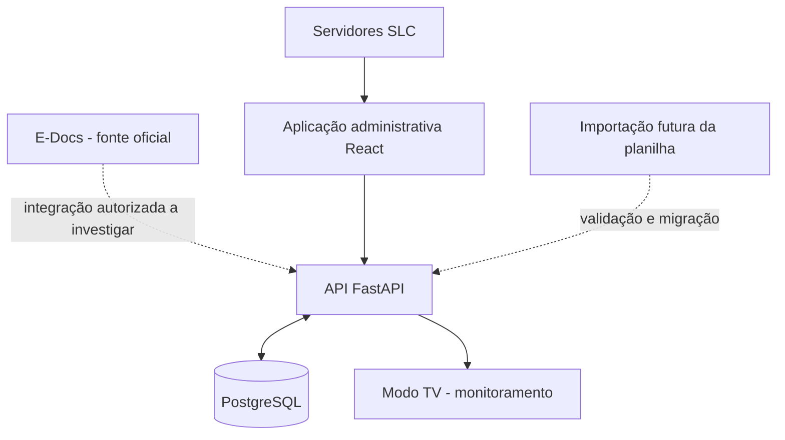

# SLC Digital — Contexto completo da conversa e especificação inicial

> **Finalidade:** arquivo de transferência de contexto para a IDE Antigravity. Este documento consolida **todas as decisões, necessidades, propostas e perguntas relevantes discutidas nesta conversa**, incluindo o histórico das mensagens do usuário. Não é uma transcrição literal integral de todas as respostas do assistente: os conteúdos extensos e protótipos visuais foram convertidos em especificações textuais para facilitar a implementação.
>
> **Estado:** planejamento inicial / descoberta. Não presumir que requisitos ainda não validados sejam regras definitivas. **Idioma do projeto:** português brasileiro.

## 1. Identificação e contexto institucional

- **Projeto:** SLC Digital — Sistema de Gestão e Monitoramento de Processos.
- **Instituição:** IPAJM — Instituto de Previdência dos Servidores do Estado do Espírito Santo.
- **Área demandante da iniciativa tecnológica:** GTI — Gerência de Tecnologia da Informação.
- **Área beneficiada:** SLC — Subgerência de Licitações e Contratos.
- **Origem:** demanda solicitada pelo gestor da GTI, para melhorar o trabalho da SLC.
- **Apresentação:** o projeto e seus resultados preliminares serão apresentados ao gestor da GTI.
- **Equipamento disponível:** **uma única TV** instalada no setor. Uma informação anterior mencionava duas TVs, mas foi **expressamente corrigida para uma**; considerar somente uma.
- **Escopo de negócio:** **todos os processos acompanhados pela SLC**, e não somente licitações ou contratos.
- **Acesso à planilha atual:** o usuário **ainda não possui** acesso; não bloquear o projeto por isso.
- **Integração com E-Docs:** disponibilidade de API ou outro meio autorizado **desconhecida**, sujeita a investigação. Não inventar endpoints ou afirmar que a integração existe.

### Contexto de atribuições da SLC

Na conversa, foram descritas atribuições relacionadas a licitações e contratações, orientação em documentos preparatórios (ETP, Termo de Referência), pesquisas de preços, formalização de contratos, prorrogações, apostilamentos, repactuações, controle de saldos, garantias e designação de gestores/fiscais. Essas informações servem como **contexto de negócio** e precisam de conferência documental institucional antes de serem tratadas como requisitos normativos. A SLC foi descrita como vinculada à Gerência Administrativa (GAD), no âmbito da Diretoria Administrativa e Financeira (DAF).

## 2. Problema identificado

A rotina atual da SLC foi descrita pelo usuário como dependente de:

1. Processos e referências do **E-Docs** representados por **papéis afixados na parede**.
2. **Planilha antiga**, usada para anotar e acompanhar documentos/processos.
3. **Quadros físicos** com números, detalhes e informações dos processos.
4. Atualizações manuais e informações distribuídas entre meios diferentes.

**Efeitos prováveis a validar:** retrabalho, desatualização, dificuldade de encontrar informações, baixa rastreabilidade, falta de visão consolidada, dificuldade de acompanhar responsáveis, pendências e prazos.

**Tom institucional:** evitar desqualificar a equipe como “arcaica”; enfatizar limitações das ferramentas e oportunidades de modernização.

## 3. Objetivo geral

Desenvolver uma **aplicação web interna de gestão e acompanhamento de processos administrativos da SLC**, com dados centralizados, painel gerencial, métricas, quadro operacional, prazos, responsáveis e **modo TV** para monitoramento visual no setor.

A aplicação será uma **camada complementar ao E-Docs**, que permanece como sistema oficial de documentos e tramitação. Não duplicar sua função oficial nem presumir possibilidade de escrever ou modificar processos no E-Docs.

### Objetivos específicos

- Centralizar informações dos processos acompanhados pela SLC.
- Substituir gradualmente controles físicos e planilhas paralelas por um fluxo digital.
- Consultar processos com busca, filtros e detalhamento.
- Visualizar responsável, categoria, situação, etapa, prioridade e prazo.
- Registrar histórico de atualizações e autoria.
- Destacar pendências, atrasos e processos sem atualização.
- Disponibilizar indicadores e relatórios úteis para a gestão.
- Apresentar informações adequadas na TV instalada no setor.
- Avaliar futura importação da planilha e integração autorizada com E-Docs.

## 4. Decisões confirmadas vs. hipóteses

| Item | Estado | Orientação |
|---|---|---|
| Demanda do gestor da GTI | Confirmado | Posicionar como iniciativa institucional da GTI. |
| Setor beneficiado SLC | Confirmado | Validar processos com servidores do setor. |
| Todos os processos da SLC | Confirmado | Cadastro central; permitir fluxos distintos por categoria. |
| Planilha concentra praticamente todos os dados | Relatado pelo usuário | Analisar quando o acesso estiver disponível. |
| Acesso à planilha | Indisponível por enquanto | Usar campos provisórios e dados fictícios. |
| Integração E-Docs | Desconhecida | Investigar mecanismos autorizados; não criar integração fictícia. |
| Uma TV instalada | Confirmado/corrigido | Um painel com diferentes telas e alternância. |
| React + TypeScript, FastAPI, PostgreSQL | Proposta técnica | Confirmar aderência à infraestrutura/padrões da GTI. |
| Kanban e situações de processos | Proposta | Validar fluxo real da SLC. |
| Atualização automática da TV | Proposta funcional | Escolher polling ou push conforme infraestrutura. |
| Temporização da TV (20–30 segundos) | Sugestão | Tornar configurável. |
| Métricas e dados numéricos apresentados nos mockups | Fictícios | Nunca tratar como indicadores reais. |

## 5. Dois ambientes da mesma aplicação

### 5.1 Ambiente administrativo (computadores dos servidores)

- Autenticação e perfis de acesso.
- Cadastro e edição de processos.
- Busca, filtros e consulta detalhada.
- Dashboard administrativo.
- Atribuição de responsáveis e prioridades.
- Gestão de etapas, pendências e prazos.
- Histórico/auditoria de alterações.
- Kanban operacional.
- Relatórios e exportações (posteriores ou conforme prioridade).

### 5.2 Ambiente de monitoramento (uma TV)

- Exibição em tela cheia, sem controles administrativos.
- Layout legível a distância e responsivo para 16:9.
- Atualização automática e indicação de **última atualização bem-sucedida**.
- Alternância entre três visões, com intervalo configurável (proposta: 20–30 s).
- Sem exibição de dados sensíveis ou sigilosos; respeitar permissões e visibilidade do ambiente físico.
- Modo de recuperação após perda de conexão; não apresentar informação antiga como se fosse atual.

**Três telas propostas para a única TV:**

1. **Visão geral:** processos ativos, pendentes, críticos, concluídos no período, distribuição por situação e alertas agregados.
2. **Acompanhamento de processos:** lista ou Kanban compacto com identificador, etapa/situação e responsável quando permitido; foco em processos prioritários.
3. **Prazos e prioridades:** vencidos, próximos de vencer, sem atualização e pendências relevantes.

A TV não será uma segunda aplicação independente: deve consumir a mesma API e dados do sistema interno, com uma interface apropriada e segura.

## 6. Módulos funcionais propostos

### M1. Dashboard gerencial — prioridade alta

Indicadores candidatos:

- Total de processos cadastrados/ativos.
- Processos em andamento, aguardando providência e concluídos.
- Processos sem atualização há X dias.
- Processos por responsável, categoria e etapa.
- Prazos próximos e vencidos.
- Recebidos e concluídos por mês.
- Tempo médio por etapa, quando houver dados confiáveis.

**Atenção:** diferenciar ausência de movimentação no E-Docs de ausência de atualização interna. Definir a fórmula de cada indicador com a SLC.

### M2. Cadastro e gerenciamento de processos — prioridade alta

Campos **provisórios** de uma ficha:

| Campo | Descrição |
|---|---|
| Identificador interno | Chave técnica no sistema. |
| Número/referência E-Docs | Referência ao processo oficial, quando houver. |
| Objeto/assunto | Descrição resumida. |
| Categoria/tipo | Classificação do processo. |
| Setor demandante | Origem da demanda. |
| Responsável | Usuário encarregado do acompanhamento. |
| Data de entrada | Recebimento pela SLC. |
| Situação/etapa | Estado do fluxo interno. |
| Prioridade | Criticidade operacional. |
| Prazo | Data limite de uma providência, com regra definida. |
| Última atualização | Carimbo de data/hora. |
| Observações | Notas internas, com controle de acesso. |
| Link para E-Docs | Link autorizado ao documento/processo original. |

Necessidades: validação, busca, filtros, paginação, rastreabilidade, controle de acesso e histórico de alterações.

### M3. Kanban e fluxo de trabalho — prioridade alta

Etapas **hipotéticas** a validar:

1. Recebido pela SLC.
2. Em análise.
3. Aguardando documentação.
4. Em elaboração.
5. Aguardando aprovação.
6. Em andamento externo.
7. Concluído.

Não fixar um único fluxo para todos os tipos de processo sem entrevistas. Registrar movimentações e seus responsáveis.

### M4. Prazos e pendências — prioridade alta

- Prazo por processo/atividade.
- Alertas de vencimento próximo e vencido.
- Pendências por servidor e categoria.
- Histórico de alterações/prorrogações.
- Identificação de processos sem atualização.
- Regras de alerta configuráveis e auditáveis.

### M5. Gestão de contratos — evolução

Campos candidatos: contrato, empresa, objeto, valores, início/fim da vigência, prorrogação, garantias, saldos, gestor/fiscais, aditivos e apostilamentos. Validar se dados estarão no módulo geral ou em extensão específica.

### M6. Relatórios e indicadores — evolução

Relatórios por período, responsável, categoria, situação, prazos, contratos e tempo de tramitação interna. Usar métricas para melhorar fluxos e não para criar classificações simplistas de produtividade individual.

### M7. Modo TV — prioridade alta

Três telas descritas na seção 5.2, controle de exibição, rotação, atualização e segurança.

## 7. Arquitetura preliminar

**Tecnologias candidatas:**

- Frontend: **React + TypeScript**, Vite e Tailwind CSS.
- Backend: **Python + FastAPI**.
- Banco: **PostgreSQL**.
- Gráficos: **Recharts** (sugestão).
- Autenticação: integração com mecanismo institucional/AD, se aprovada e viável.
- Controle de versão: Git.

**Fluxo lógico:**



Requisitos transversais: autenticação, RBAC, trilha de auditoria, backups, disponibilidade, proteção de dados pessoais, gestão de segredos, política de retenção, conformidade institucional e validação de infraestrutura com a GTI.

**Integração E-Docs:** investigar documentação e autorização. Até lá, permitir cadastro manual e, depois, importação assistida da planilha. Evitar scraping ou mecanismos não autorizados.

## 8. Estratégia de implementação incremental

### Fase 1 — Descoberta e diagnóstico

- Entrevistas com a SLC e GTI.
- Observar a rotina real e os controles físicos.
- Quando disponível, analisar a planilha e suas abas/colunas.
- Levantar fluxos, papéis, categorias, regras de prazo e dados sensíveis.
- Investigar integração E-Docs e infraestrutura.

**Entrega:** diagnóstico e requisitos validados.

### Fase 2 — Modelagem e prototipação

- Mapear fluxos atuais e futuros.
- Definir taxonomia, etapas, permissões e indicadores.
- Elaborar protótipos do sistema e da TV.
- Definir modelo inicial de dados e contratos da API.

**Entrega:** protótipo navegável e especificação técnica inicial.

### Fase 3 — MVP operacional

- Autenticação/controle de acesso.
- CRUD de processos.
- Busca e filtros.
- Responsáveis e situações.
- Histórico de atualizações.
- Dashboard básico.
- Kanban e prazos essenciais.
- Modo TV com três telas.

**Entrega:** primeira versão funcional em ambiente de teste.

### Fase 4 — Validação e implantação gradual

- Testar com usuários da SLC.
- Corrigir divergências entre protótipo e fluxo real.
- Preparar importação de dados quando possível.
- Verificar segurança, desempenho, backup e suporte.
- Treinar usuários e planejar adoção.

**Entrega:** implantação autorizada, com critérios de aceite definidos.

### Fase 5 — Evolução

- Gestão contratual mais profunda.
- Relatórios avançados.
- Notificações.
- Integração E-Docs, **somente se houver meio autorizado e tecnicamente viável**.

## 9. MVP: histórias de usuário iniciais

- **US-01:** Como servidor da SLC, quero cadastrar um processo para acompanhá-lo centralmente.
- **US-02:** Como servidor, quero pesquisar pelo número E-Docs ou assunto para localizar rapidamente um processo.
- **US-03:** Como servidor, quero visualizar e atualizar a situação de um processo para registrar o andamento interno.
- **US-04:** Como servidor, quero associar responsáveis e prazos para organizar as atividades.
- **US-05:** Como servidor, quero consultar o histórico para entender o que foi alterado e por quem.
- **US-06:** Como gestor, quero visualizar indicadores agregados para identificar gargalos.
- **US-07:** Como equipe, quero visualizar os processos em Kanban para acompanhar o trabalho.
- **US-08:** Como equipe, quero visualizar o modo TV para acompanhar o setor sem depender de quadros físicos.
- **US-09:** Como administrador autorizado, quero controlar permissões e quais campos podem aparecer na TV.
- **US-10:** Como usuário, quero acessar o processo original no E-Docs por um link autorizado, quando disponível.

### Critérios iniciais de aceite do protótipo

- Navegação entre dashboard, processos e modo TV.
- Dados demonstrativos claramente rotulados como fictícios.
- Busca/filtros funcionais no protótipo.
- Uma única TV com três modos de visualização e alternância configurável.
- Interface legível em tela grande.
- Nenhuma dependência de API E-Docs não confirmada.

## 10. Riscos e dependências

| Risco/dependência | Mitigação proposta |
|---|---|
| Planilha ainda inacessível | Modelar provisoriamente; validar depois. |
| Fluxos reais desconhecidos | Entrevistas e validação com a SLC antes de fixar etapas. |
| Integração E-Docs incerta | MVP independente, cadastro manual e importação futura. |
| Informação desatualizada | Exibir horário da atualização; estabelecer responsáveis pela manutenção. |
| Exposição de dados na TV | Filtrar informações, restringir acesso e avaliar posição física da TV. |
| Adoção pelos servidores | Envolver equipe desde o protótipo, treinamento e migração gradual. |
| Infraestrutura e suporte | Validar hospedagem, autenticação, backups e operação com a GTI. |
| Indicadores mal definidos | Formalizar fórmulas, filtros, período e fontes de dados. |

## 11. Como apresentar ao gestor da GTI

**Enquadramento:** a demanda já foi solicitada pelo gestor da GTI. Portanto, a apresentação não deve fingir que a ideia surgiu como proposta externa ou que já existe aprovação de todas as decisões técnicas. Deve mostrar diagnóstico preliminar, desenho da solução, protótipo, benefícios, riscos e próximos passos.

Roteiro recomendado:

1. Situação atual e impacto dos controles físicos/planilhas.
2. Objetivo da modernização e valor institucional.
3. Visão do SLC Digital: aplicação + painel na TV.
4. Demonstração do dashboard, cadastro, Kanban e TV.
5. Arquitetura e estratégia sem dependência imediata do E-Docs.
6. Plano de implementação incremental.
7. Decisões necessárias: acesso à SLC, dados, infraestrutura e prioridades.

Texto de apresentação sugerido:

> O SLC Digital é uma iniciativa da Gerência de Tecnologia da Informação do IPAJM para modernizar o acompanhamento dos processos administrativos da Subgerência de Licitações e Contratos. A solução contempla uma aplicação web de gerenciamento centralizado e um painel digital de monitoramento, aproveitando a televisão já instalada no setor. Busca reduzir a dependência de planilhas e controles físicos, melhorar a rastreabilidade e ampliar a visibilidade operacional, respeitando o E-Docs como sistema oficial de tramitação.

## 12. Histórico da conversa — falas do usuário, em ordem

As falas abaixo preservam o conteúdo informado pelo usuário nesta conversa:

1. **Pergunta inicial:** “chat, o que você sabe sobre a SLC (Subgerência de Licitações e Contratos) do IPAJM?”
2. **Descrição da demanda:** “Incrivel, agora vamos para a tarefa. Atualmente a SLC exerce suas atividades de forma muito ‘arcaica’. Visualização de processos (via E-Docs) colados com papéis na parede do setor, utilizam uma planilha bem antiga para fazer a anotação dos documentos/processos, anotam números e detalhes dos processos em quadros… e afins. A premissa é elaborar um plano de elaboração para inovar o método de trabalho trazendo uma grande melhoria no dia a dia do setor como um todo. Minha principal ideia é desenvolver uma aplicação de gerenciamento com dashboard, métricas e afins, onde os usuários da SLC terão a visualização dos processos que são entranhados no E-Docs com suas respectivas informações”.
3. **Respostas do levantamento:** “Minhas respostas para o levantamento da aplicação da SLC: 1. Planilha: sim 2. Integração E-Docs: nao_sei 3. Escopo: todos Informações adicionais:”
4. **Disponibilidade de dados:** “ainda não tenho acesso a planilha”.
5. **Destinatário da apresentação:** “irei apresentar para o gestor de GTI”.
6. **Origem da demanda e informação inicial sobre TVs:** “é uma demanda solicitada pelo gestor da GTI pois precisamos trazer a melhoria para o setor da SLC. ah lembrando, já foram adicionadas duas TV's no setor da SLC então seria interessante trazer um modelo de apresentação dos processos”.
7. **Correção definitiva do número de TVs:** “foi adicionada apenas uma tb”.
8. **Autorização para iniciar:** “quero que dê inicio ao projeto com o que foi discutido e definido nessa conversa de hoje”.
9. **Pedido atual:** “quero que traga toda essa conversa para um arquivo .md para que eu possa jogar na IDE do antigravity”.

### Síntese das respostas do assistente durante a conversa

- Apresentou contexto geral das atribuições e estrutura da SLC.
- Identificou fragmentação entre E-Docs, planilha e controles físicos.
- Propôs aplicação web complementar ao E-Docs, com dashboard, cadastro, Kanban, prazos, relatórios e gestão contratual futura.
- Recomendou investigação de integração E-Docs e operação inicial sem essa dependência.
- Sugeriu React/TypeScript, FastAPI, PostgreSQL, Tailwind e Recharts.
- Recomendou levantamento, modelagem, prototipação, MVP, implantação e evolução.
- Sugeriu proposta institucional para apresentação à GTI.
- Inicialmente desenhou duas TVs; **após correção do usuário, redefiniu a solução para uma TV com três telas alternáveis**.
- Apresentou exemplos visuais de dashboards e processos com **dados fictícios** (como 128 ativos, 34 pendentes, 7 críticos, 42 concluídos); esses valores não são dados reais.
- Informou ter iniciado um pacote de projeto v0.1 com documentação e protótipo HTML; o pacote foi identificado na conversa como `slc-digital-inicio.zip`. Sua existência no ambiente da IDE deverá ser verificada separadamente; este Markdown é autossuficiente.

## 13. Instruções para o agente de programação no Antigravity

**Papel esperado:** atuar como arquiteto de software e desenvolvedor full-stack do projeto SLC Digital, usando este documento como contexto inicial.

**Prioridades:**

1. Ler este arquivo por completo antes de propor alterações.
2. Distinguir fatos confirmados de hipóteses.
3. Não inventar integração, dados ou regras da SLC.
4. Propor estrutura de repositório e backlog técnico incremental.
5. Implementar primeiro um protótipo/MVP desacoplado de E-Docs, com dados fictícios identificados.
6. Considerar **uma TV** com três visualizações e configuração de rotação.
7. Preparar modelo de dados e endpoints para evolução sem antecipar fluxos ainda não validados.
8. Adotar segurança, logs de auditoria e restrição de dados na TV desde a concepção.
9. Manter documentação em português e registrar decisões arquiteturais.
10. Antes de integração institucional ou produção, solicitar validação com GTI e SLC.

### Estrutura de repositório sugerida

```text
slc-digital/
├── README.md
├── docs/
│   ├── contexto-projeto.md
│   ├── requisitos.md
│   ├── arquitetura.md
│   ├── modelo-dados.md
│   ├── backlog.md
│   └── decisoes/
├── frontend/
│   └── ... React + TypeScript + Vite
├── backend/
│   └── ... FastAPI
├── database/
│   └── ... migrations / seeds fictícios
└── prototypes/
    └── ... demonstração do modo TV
```

### Primeira tarefa sugerida para o Antigravity

> Com base neste arquivo, faça uma leitura crítica dos requisitos, apresente as decisões confirmadas e as pendências, proponha a arquitetura inicial do MVP e crie a estrutura do projeto com frontend React/TypeScript e backend FastAPI. Desenvolva um dashboard demonstrativo, uma lista de processos e o modo TV com três visualizações. Use somente dados fictícios, não presuma integração E-Docs e documente claramente o que depende de validação com a SLC/GTI. Não implemente autenticação simulada como se fosse autenticação institucional real.

## 14. Questões abertas para próxima reunião com a SLC/GTI

- Quais são as abas e colunas da planilha atual?
- Quais tipos de processos existem e como diferem os fluxos?
- Como se define entrada, saída, conclusão e arquivamento de um processo na SLC?
- Quais situações e prazos são efetivamente utilizados?
- Quem pode cadastrar, alterar, atribuir e encerrar processos?
- Quais informações podem aparecer na TV e quem pode vê-la?
- A TV dispõe de navegador, computador conectado ou dispositivo dedicado?
- Existe API/documentação/autorização de consulta ao E-Docs?
- Qual a infraestrutura aprovada para hospedar o sistema?
- Como serão tratados dados sensíveis, logs, backups e retenção?
- Quais indicadores realmente ajudam a equipe e a chefia?
- Quem manterá os dados atualizados enquanto não houver integração?

---

**Regra de ouro:** começar com uma solução utilizável e validável, mas nunca transformar suposições em requisitos institucionais sem confirmação.
